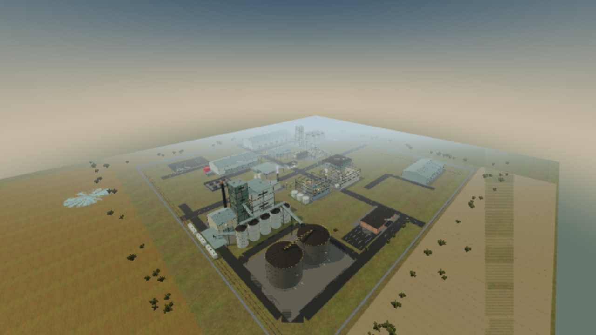
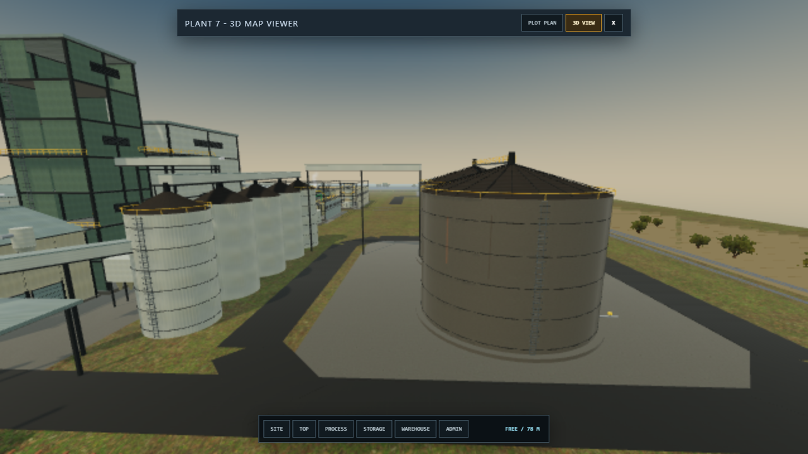

# AlarmState: Plant 7

**A first-person industrial automation apprenticeship built around one live soybean-processing plant.**

AlarmState combines a continuous 12-week campaign, a simulated Plant 7 controller, an embedded ESCO Automation Studio, live HMI diagnostics, and 2-4 player LAN co-op. Players do not select lessons from a separate course menu. They report to dispatch, walk to real plant equipment, investigate production faults, program or diagnose the controller, and prove the repair against the running simulation.



## What makes AlarmState different

- **One continuous plant:** all 21 assignments happen inside the same persistent facility.
- **Real controller behavior:** ladder routines scan continuously against live process values.
- **ESCO everywhere:** logic, HMI, alarms, trends, diagnostics, and practical validation use the embedded studio.
- **No supplied rung answers:** each work order provides the problem, required outcome, variable bank, and one conceptual hint.
- **Real progression:** accepted ESCO work is archived into a final course portfolio before the workspace is cleared for the next assignment.
- **Production pressure:** faults escalate through warning, critical, and shutdown states while score and qualification consequences continue to move.
- **Crew Response:** two to four players split controls, HMI, field, and maintenance responsibilities in the same incident.
- **Inspectable campus:** the plot plan and interactive 3D map provide six plant viewpoints, orbit controls, and zoom.

## Quick start

### Requirements

- Node.js 20 or newer
- npm
- A modern browser with WebGL enabled

### Install and run

```powershell
git clone https://github.com/The-ESCO-Group/AlarmState.git
cd AlarmState
npm.cmd install
npm.cmd run start:multi
```

Open [http://127.0.0.1:5191/](http://127.0.0.1:5191/).

`start:multi` serves the complete game and enables Crew Response. For a simple static single-player server, run `npm.cmd run start:local` and open [http://127.0.0.1:5190/](http://127.0.0.1:5190/).

The commands use `npm.cmd` so they work in Windows PowerShell even when script execution blocks `npm.ps1`. On macOS or Linux, use `npm` instead.

## The campaign

You are T. Ryder, a newly hired controls technician at Prairie Gold Processing Plant 7. The plant failed its alarm-management audit because operators stopped trusting its indications and controls. Your job is to rebuild that trust, earn field authorization, and keep the site running through final acceptance.

The normal shift loop is:

1. Report to the Reliability Center dispatch desk.
2. Accept the next unlocked work order.
3. Follow the plant marker or map to the assigned equipment.
4. Inspect the physical process, HMI evidence, and controller state.
5. Program, diagnose, or commission the required system in ESCO.
6. Prove the result against the live simulation.
7. Return to dispatch for scoring and debrief.

Progress is stored locally in the browser.

## Twelve-week qualification

| Phase | Focus |
| --- | --- |
| Weeks 1-2 | PLC fundamentals, tags, safe start/stop logic, photoeye conditioning, and one-count-per-carton logic |
| Weeks 3-4 | Fault latching, timers, resets, motor permissives, alarm indication, and operator HMI construction |
| Weeks 5-7 | Bean Prep, Extraction, desolventizer-toaster, interlocks, process evidence, and alarm response |
| Weeks 8-9 | Refinery, Utilities, Meal, analog conditions, trends, and cross-area troubleshooting |
| Weeks 10-11 | Multi-area incidents, incomplete evidence, team response, and graveyard-shift escalation |
| Week 12 | Final Plant 7 acceptance and review of the assembled ESCO course portfolio |

The game currently contains 21 practical assignments and 10 production fault scenarios.

## ESCO Automation Studio

ESCO is not a separate side panel or an answer screen. It opens when a work order requires controller or HMI work and remains part of the practical until the submitted project passes.

The integrated studio provides:

- Studio 5000-style ladder editing and controller organization
- mission-specific tag banks with names, types, I/O roles, and engineering descriptions
- contacts, coils, branches, timers, counters, latches, resets, comparisons, math, and subroutine structure
- HMI display construction, live tags, alarm summary, and trends
- project verification and practical-specific acceptance checks
- automatic archival of passed work into the final qualification portfolio

Assignments explain the plant problem and required result without inserting a completed rung or HMI answer.

## Plant 7 controller

Plant 7 runs one controller project, `PGP_Plant7_PLC`, defined in `js/data/plant-logic.js` and scanned by `js/plc.js`.

Current conformance coverage includes:

- 5 programs
- 16 routines
- 149 ladder rungs
- 280 tags
- 50 alarm definitions
- 9 deliberately broken controller variants that must be rejected

The scan engine implements series AND, parallel OR, timer accumulation, counter state, retained latches, output propagation, subroutine calls, and controller tag members. Alarm bits, motor commands, permissives, trips, and reset behavior are produced from the same live process values used by the game and HMI.

Controller rules enforced by automated tests include:

- no writing to physical input tags
- one `OTE` writer per Boolean output
- no output coil placed after the timer that delays it
- no empty branch paths
- every retained trip has a valid reset path
- every routine is reachable from its program main routine
- motor starters use valid seal-in, stop, and permissive structure

## Crew Response multiplayer

Crew Response is a server-authoritative LAN mode for two to four players.

| Role | Responsibility |
| --- | --- |
| Controls Technician | Inspect ESCO Logic and submit the defensible failed I/O point |
| Control Room Operator | Operate the prebuilt HMI, alarms, and process trends |
| Field Operator | Reach the equipment and report physical process evidence |
| Maintenance Lead | Prove mechanical and maintenance conditions that controls cannot see |

The server owns room membership, unique role assignment, incident timing, alarm escalation, strikes, score, answer validation, and reconnect tokens. A disconnected player has 60 seconds to reclaim the same callsign and role.

To join from another computer on the same network, open `http://HOST-PC-IP:5191/` and enter the five-character room code or use the copied invite link.

## Plant 7

The playable soybean extraction and refining campus includes:

- truck receiving pits, scale house, bucket elevator, storage silos, and transfer galleries
- Bean Prep, Extraction, DT, Refinery, Utilities, Meal, and central control areas
- portal-frame warehouses, preparation and headhouse towers, loading bays, and process service floors
- Reliability Center dispatch, ESCO engineering workstations, HMI design studio, and CV-101 training cell
- maintenance and instrument shop, MCC buildings, packaging, finished-goods storage, and fire-water systems
- rail spurs, electrical substation, tank farms, pipe racks, roads, parking, and perimeter landscaping

The world uses local physically based materials and a CC0 modular industrial architecture asset while retaining optimized browser draw calls.



## Controls

| Key | Action |
| --- | --- |
| `WASD` | Move |
| `Shift` | Run |
| `E` | Interact |
| `M` | Open plot plan / 3D map |
| `R` | Radio |
| `H` | Open live ESCO HMI |
| `Tab` | Open live ESCO Logic |
| `Enter` | Submit root-cause tag when prompted |
| `Esc` | Pause or close the active workstation |

## Validation

Run the core suite:

```powershell
npm.cmd run check
```

With the multiplayer server running, the visual and end-to-end checks are:

```powershell
npm.cmd run test:browser
node tests/map-viewer-qa.cjs
node tests/architecture-qa.cjs
node tests/render-profile.cjs
```

Additional focused checks are available through:

```powershell
npm.cmd run test:plc
npm.cmd run test:plant7-ladder
npm.cmd run test:multitab
npm.cmd run test:completion
```

The tests cover course routing, ESCO validators, controller conformance, injected ladder defects, incident evidence, room isolation, unique multiplayer roles, reconnect recovery, shared scoring, 3D rendering, map controls, and a complete two-client incident.

## Project map

```text
index.html                       application shell and game overlays
css/style.css                    HUD, ESCO, course, multiplayer, and map UI
js/main.js                       browser bootstrap, input, camera, and UI wiring
js/world.js                      Plant 7 world, architecture, materials, and routing
js/campaign.js                   continuous apprenticeship progression
js/course.js                     12-week work orders and assignment data
js/game.js                       incident state, escalation, score, and debriefs
js/esco.js                       ESCO workspace integration and validation
js/plc.js                        ladder scan engine
js/data/plant-logic.js           PGP_Plant7_PLC controller definition
js/plant7-esco.js                controller-to-ESCO project generation
js/multiplayer.js                room client, roles, and shared gameplay
server/rooms.mjs                 authoritative room and incident state
server/multiplayer-server.mjs    HTTP and WebSocket LAN server
tests/                           controller, campaign, multiplayer, and browser QA
assets/                          local PBR materials, architecture, and vegetation
```

## Asset licensing

AlarmState source code is available under the [MIT License](LICENSE).

The PBR textures, modular factory facade, and vegetation source used by the Plant 7 world are CC0 assets from Poly Haven. Source and usage notes are stored beside the assets:

- [PBR texture attribution](assets/textures/polyhaven/README.md)
- [Architecture attribution](assets/models/polyhaven/README.md)
- [Vegetation attribution](assets/vegetation/polyhaven/README.md)

## Safety scope

AlarmState is a simulation and training game. It does not connect to real PLCs, industrial networks, field devices, machinery, or external hardware. Do not use the game as a substitute for site-specific procedures, qualified supervision, or applicable electrical and process-safety standards.
